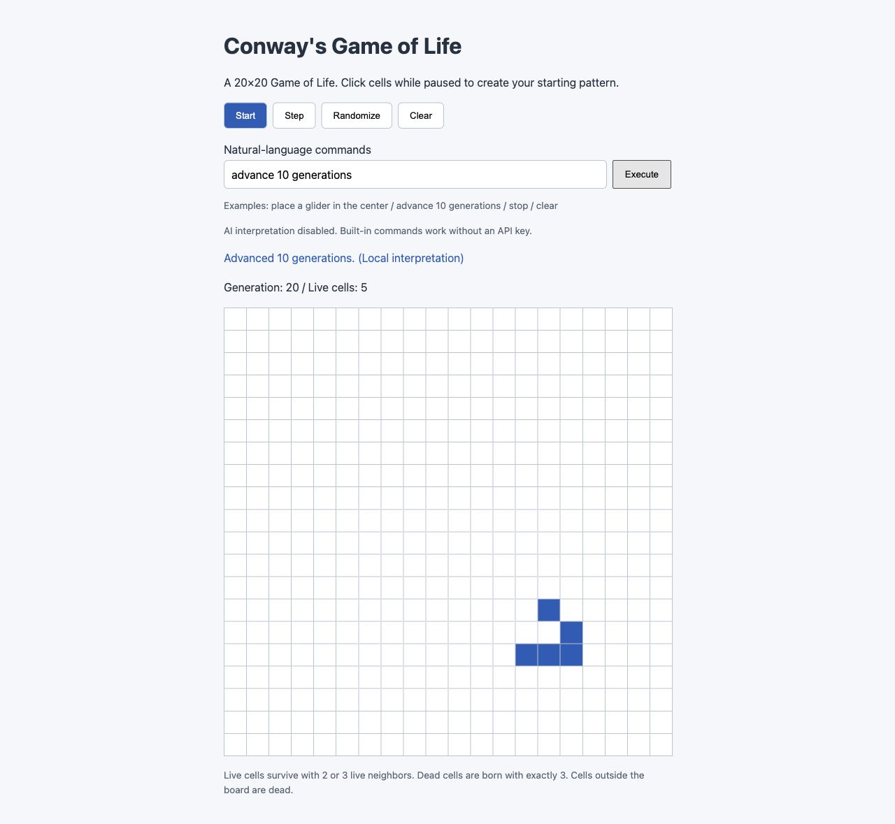

# Life Lab AI

[English](README.md) | 日本語

Python / Flask製の20×20のConway's Game of Lifeです。
ブラウザーでの操作に加え、自然言語の指示入力とMCP（stdio / Streamable HTTP）からの操作に対応します。
ローカルで動かす学習・実験用のサンプルです。



## できること

- セルのクリック編集、開始／停止、1世代更新、ランダム配置、クリア
- グライダー、ブリンカー、ブロックの配置
- 自然言語の指示をローカルルールで解析し、未対応の表現は任意でOpenAIに解釈を依頼
- MCPから盤面を取得・操作し、ブラウザーにも反映
- 複数ブラウザーとMCPで同じ盤面を共有し、revisionによって編集の競合を検出

盤面の外側は死んだセルとして扱い、端同士はつながりません。
盤面はFlaskプロセスのメモリー内に保持します。再読み込みでは保持され、サーバー再起動でリセットされます。

## 起動

Python 3.10以上が必要です。ダウンロードまたはcloneしたプロジェクトのディレクトリで実行します。

```bash
python3 -m venv .venv
source .venv/bin/activate
python -m pip install -r requirements.txt
python app.py
```

Windowsの場合、仮想環境の有効化は `.venv\Scripts\activate` を使います。
ブラウザーで <http://127.0.0.1:5000> を開きます。終了はCtrl+Cです。

## 自然言語で操作

画面は英語表示です。入力欄に英語または日本語の指示を入れて「Execute」を押します。次の例はAPIキーなしで使えます。

| 指示例 | 操作 |
| --- | --- |
| `中央にグライダーを置いて` | 既存のセルを残してパターンを追加 |
| `左上にブリンカーを置いて` | 左上に配置 |
| `右下にブロックを置いて` | 右下に配置 |
| `3行5列を生存にして` | 1セルを変更。死亡の指定も可能 |
| `10世代進めて` | 1〜100世代を進める |
| `開始` / `停止` | 自動更新の切り替え |
| `ランダム` / `クリア` | 盤面を置き換え、世代数を0に戻す |

配置・セル変更・手動の世代更新は自動再生を停止します。
行と列は1〜20です。範囲外の指定や未対応の指示はエラーにします。

### OpenAIによる解釈（任意）

Flaskを起動するターミナルで `OPENAI_API_KEY` を環境変数として設定します。
APIキーをソース、README、MCP設定例、ブラウザーに記入しないでください。
macOS / Linuxでは、キーをコマンド履歴に残さず入力する例として次の方法があります。

```bash
read -r -s -p 'OpenAI API key: ' OPENAI_API_KEY
printf '\n'
export OPENAI_API_KEY
export OPENAI_MODEL='gpt-4o-mini'  # 任意。省略時も同じモデル
python app.py
```

ローカルで解釈できない指示だけをOpenAI Responses APIへ送信します。
例：`盤面を空にしてから真ん中にグライダーを配置して`。
送信するのは指示文のみで、盤面は送信しません。API利用には料金が発生する場合があります。
`.env` ファイルの自動読み込みは実装していません。

AIの出力は許可された操作として検証し、最大10件の全操作が有効な場合のみ適用します。
任意のコード実行、盤面の観察、未対応パターンの生成には対応しません。
実APIへの接続・モデルの利用可否は、利用者の環境で確認してください。

## MCP接続

Flaskアプリを起動してから、MCPクライアントを接続します。
MCP操作自体にはOpenAI APIキーは不要です。

### stdio

`mcp-config.example.json` は `mcpServers` 形式のクライアント向け設定例です。
`/absolute/path/to/life-lab-ai` を自分の絶対パスに置き換えてください。
設定形式はクライアントによって異なります。

```json
{
  "mcpServers": {
    "life-lab": {
      "command": "/absolute/path/to/life-lab-ai/.venv/bin/python",
      "args": ["/absolute/path/to/life-lab-ai/mcp_server.py"],
      "env": { "LIFE_APP_URL": "http://127.0.0.1:5000" }
    }
  }
}
```

WindowsではPythonのパスを `.venv/Scripts/python.exe` に変更してください。
MCPクライアントがサーバープロセスを起動します。stdioに接続用URLはありません。

### Streamable HTTP

別のターミナルで仮想環境を有効にし、MCPサーバーを起動します。

```bash
python mcp_server.py --transport streamable-http --port 8000
```

MCPクライアントで接続方式を **Streamable HTTP**、URLを **http://127.0.0.1:8000/mcp** に設定します。
このURLはMCPプロトコル用で、通常のWebページではありません。
Flaskのポートを変更した場合は環境変数 `LIFE_APP_URL` を変更します。
終了はCtrl+Cです。起動オプションを省略するとstdio方式になります。

### ツール

| ツール | 操作 |
| --- | --- |
| `get_board` | 盤面・世代数・生存数・再生状態・revisionを取得 |
| `set_cell` | `row`, `col`, `alive` で1セルを変更 |
| `place_pattern` | `pattern` は `glider` / `blinker` / `block`。`row`, `col` は左上座標（省略時9,9） |
| `step_generation` | `steps` 世代進める（省略時1、最大100） |
| `clear_board` | 全消去、世代数0、再生停止 |
| `randomize_board` | 約30%を生存にして世代数0、再生停止 |
| `start_game` | 毎秒4世代で自動更新を開始 |
| `stop_game` | 自動更新を停止 |

編集ツールに読み取り時の `revision` を渡すと、他の操作が先に行われた場合に変更を拒否できます。
自動更新はサーバーの経過時間に基づき、読み取り・操作時に計算します。
ブラウザーは250msごとに取得するため、複数ブラウザーでも世代の進行速度は増えません。

## セキュリティと制限

- FlaskとHTTP MCPは127.0.0.1で待ち受けます。認証のないローカル実験用で、同じ端末のプロセスはアクセスできます。
- 公開リポジトリにソースを置くことと、サーバーをインターネットに公開することは別です。このアプリは外部公開・複数利用者向けの認証に対応していません。
- MCPの接続先Flask URLはlocalhostまたは127.0.0.1に制限し、HTTP MCPではSDKのHost/Origin検証を使用します。
- AIの操作には種類・座標・世代数の検証を行い、生成されたコードを実行しません。
- 指示文には秘密情報を入力しないでください。OpenAI解釈を有効にすると、ローカル解析できない指示文を外部APIに送ります。
- `.env`、鍵ファイル、ローカル設定、仮想環境、キャッシュは `.gitignore` の対象です。公開前に登録対象を確認してください。
- 盤面は1つのFlaskプロセスに属し、データベース保存や複数ワーカーには対応していません。

## テスト

仮想環境を有効にして実行します。

```bash
python -m unittest discover -s tests -v
```

ルール計算、自然言語解析、AIの模擬応答、操作検証、競合検出、stdio／HTTPのMCP実接続を確認します。
MCPテストは独立した盤面、一時的なlocalhostポートと子プロセスを使い、終了時に停止します。
OpenAIとの実通信や全OSでの動作を保証するテストではありません。

## 構成

```text
app.py                    Flaskと盤面API
commands.py               指示の解析・操作の検証と実行
shared_board.py           共有盤面とrevision管理
mcp_server.py             MCPツールと接続方式
mcp-config.example.json   stdio設定例
static/                   JavaScriptとCSS
templates/                HTML
tests/                    自動テスト
docs/screenshot.jpg       画面例
```

互換用の `/api/step` と `/api/command` は独立計算APIです。
共有盤面には `/api/board`、`/api/board/actions`、`/api/board/command` を使います。

## ライセンス

[MIT License](LICENSE)
